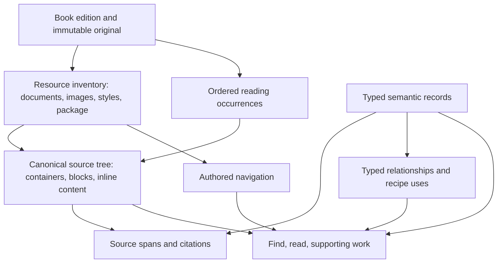

# Whole-book model draft

Preserve the complete ordered source content, then attach strict, typed records
for its meanings. This allows a chapter essay, an ingredient table, a quotation,
a recipe, and a flavor-reference entry to remain readable while becoming useful
query targets. Recipe recognition can improve without re-creating or losing the
book's prose.

This is a model proposal backed by a private EPUB prototype. It does not change
the publisher, deployed MCP, existing publication, or current recipe tools.
The machine-readable contract is
[whole-book.draft-v1.schema.json](schemas/whole-book.draft-v1.schema.json).
Terminology is in [CONTEXT.md](../CONTEXT.md).

## Alternatives compared

An ordered-document interface offers the clearest source ownership and the
smallest reading interface. Its semantic filters need typed records over the
document before callers can ask about ingredients or supporting preparations.

A typed-graph interface offers flexible reference, attribution, and preparation
relationships. Exposing generic graph queries would make each caller learn
book assembly and traversal rules; strict source order is still necessary.

A recipe-oriented reader makes ordinary recipe retrieval convenient. Preserving
the entire book requires independently addressable prose, reference entries,
and source navigation beneath that interface.

The recommendation combines ordered source ownership with a finite semantic
graph and a small reader interface. Extraction and relationship changes remain
inside one module, so search, reading, and matching share the same interpretation.

## Model structure



The source tree owns native text once. Semantic records reference source spans;
they do not own another transcription of the same paragraphs. Their selections
may overlap, be discontiguous, or continue across files. An essay about a recipe
can be a separately addressable passage while remaining in its original chapter.

The original artifact remains authoritative. Resource inventory includes styles,
fonts, images, package metadata, navigation, and unrecognized resources. The
EPUB draft captures document bodies as rich ordered trees; it does not replace
the original bytes or promise identical CSS presentation. Content that depends
on CSS, unsupported objects, or image text needs separate interpretation.

## Source records

| Record | Responsibility |
| --- | --- |
| `Edition` | Title, authors, source hash, format, originating publication. |
| `ModelSnapshot` | Version and identity of the extraction/interpretation over those sources. |
| `Resource` | Every original archive member, its path, size, media type, and role. |
| `SourceDocument` | One source document, root node, body-text hash, parser diagnostics. |
| `ReadingOccurrence` | One occurrence in the EPUB spine, including repeated references and linearity. |
| `ContentNode` | Ordered elements and text/tail runs with precise source locations. |
| `SourceSpan` | Ordered ranges within an edition, with optional reading-occurrence identity. |
| `SourceLink` | Original URI, source position, and resolved, external, or unresolved target. |
| `NavigationEntry` | Authored TOC, landmarks, page list, or NCX hierarchy and targets. |

Document identity and reading occurrence are distinct. A source document can
appear twice in the spine without storing its text twice or losing the second
placement. A non-spine document retains its own identity without an invented
position in the main reading sequence.

Content nodes retain paragraphs, headings, lists/items, table sections/rows/cells,
figures, captions, asides, quotations, and code. Rich inline content retains text,
emphasis, superscripts/subscripts, links, line breaks, anchors, images, and math.
Unknown markup keeps its source tag, attributes, children, and location with an
`unclassified` kind. Original tag names and attributes remain source facts; a
publisher's CSS class alone does not establish a semantic interpretation.

Table cells retain their original row membership, column order, rowspan, colspan,
and mixed content. Derived table coordinates refer to the original cells rather
than copying their text into every covered coordinate. Styling can encode a
header or a flavor ranking; such meanings need a supported interpretation and
the relevant legend, not an assumption based on appearance.

Images are positioned content occurrences referencing resources. A resource can
appear many times inside paragraphs or headings. Retaining it does not establish
that its text is readable, that it is a photograph, or that it belongs to one
recipe. Generic alt labels do not supply missing transcriptions.

## Semantic records

| Record | Meaning and access |
| --- | --- |
| `ContentDivision` | Part, chapter, section, front matter, or back matter, with semantic parentage and content selection. |
| `Passage` | Essay, technique, headnote, sidebar, note, glossary, index, menu, quotation, troubleshooting, make-ahead guidance, or prose. |
| `ReferenceEntry` | Ingredient, wine, region, cuisine, equipment, technique, or other subject entry. |
| `Recipe` | An authored preparation and its main content selection, yield, and separate parsing/supporting-work states. |
| `RecipePart` | A local preparation, ingredient/method group, equipment, assembly, or variation; parts can nest. |
| `RecipeIngredient` | One requirement with raw source selection, interpreted name/quantity/preparation, and formulation membership. |
| `Instruction` | One authored instruction selection in order, scoped to a part and formulation where known. |
| `RecipeFormulation` | A named ingredient set and yield, including alternative batch sizes with shared methods. |
| `IngredientAllocation` | A portion of an ingredient used at a particular instruction or stage. |
| `RecipeUse` | Another preparation's requiredness, target, quantity consumed, selected batch/variation, scope, and modifications. |
| `RecipeChoice` | Alternative uses or other source-described options, such as homemade versus purchased. |
| `Attribution` | Speaker, role, and intermediary for attributed prose. |
| `AttributeAssertion` | An entry's source-described property and value. |
| `PairingAssertion` | A flavor combination preserving its complete participant group and source recommendation. |

Chapter parentage is independent of DOM parentage and navigation. Authored
headings can be siblings in one source container while describing a chapter and
its sections. Chapters can also span multiple documents. Navigation is retained
even when the meaning or boundary of its target is unresolved.

Reference entries support books that organize knowledge around ingredients,
cuisines, wines, or regions. Their property labels are interpreted in their own
context: a reference work's flavor "Weight" or "Volume" need not be a physical
quantity. A group flavor recommendation remains one assertion; splitting it
into pairwise recommendations would change what the book says. Attributed
narrative remains a passage unless separately supported assertions are extracted.

Relationships have a finite vocabulary: containment, subject association,
see-also, attribution, variation, note/caption association, ingredient use in an
instruction, and geographic parentage. The draft uses explicit endpoint IDs and
source evidence. Generalized subject identities, person registries, and
normalized ingredient dictionaries can be added after actual access needs
justify them; original labels remain available.

## Quantities, formulations, and supporting work

Quantities form a tagged expression tree:

- A measured quantity uses an exact rational amount, authored unit, qualifiers,
  and optional per-serving, per-item, or per-batch basis.
- A sum expresses additions; an equivalent expression expresses two authored
  ways to measure the same requirement; an alternative expresses a choice.
- A range retains lower and upper measured values.
- A qualitative expression retains wording such as "to taste" or "remaining."
- A preparation fraction identifies the recipe use whose yield is being used.

For a synthetic example, `100 g | ½ cup + 1 tablespoon` is an equivalent
expression containing a sum. It is not three ingredient requirements. Raw rich
cells remain accessible regardless of whether their quantity has been parsed.
Normalized quantities never erase the source's unit or imply an experimentally
verified conversion.

Amount consumed, preparation yield, and batch selection are separate facts.
Selecting a small batch does not mean all of it is consumed. Two batch tables
must not be added together. Shared instructions can apply to both formulations;
a formulation-specific ingredient refers only to its own formulation.

An ingredient may have stage allocations even if the source gives it in one row.
Line breaks and individual method references preserve that distinction. A total
or remainder computed by arithmetic would be a derived value with its own
provenance; the draft retains authored portions and wording instead.

An original hyperlink is navigational evidence. A `RecipeUse` is a separate
interpretation of preparation work. Required, optional, alternative, contextual,
and technique references have different behavior. Plain prose may establish a
relationship without containing a hyperlink. A contextual backlink must not
create a required preparation cycle.

Each use records its selected formulation/variation and whether the source asks
for the whole preparation or only part. A source-described partial preparation
remains readable when exact instruction mapping is unresolved. Expanding it to
the whole parent recipe would be an incorrect workload. Known variation text
can be read directly without pretending its changed method has been fully
combined with the base recipe.

## Evidence, uncertainty, and validation

Each semantic record has source spans, an interpretation method, and a state.
Every interpreted field uses `FieldValue<T>` with a tagged state:

- `unparsed`: interpretation has not been attempted.
- `source_unspecified`: the examined source does not state this field; the
  explanation and enclosing evidence define the scope of that absence.
- `candidate`: a proposed value with source evidence.
- `supported`: a value supported by inspected source evidence.
- `unresolved`: an attempted interpretation remains uncertain, with explanation.

Populated fields require non-null values and evidence. Absent or unresolved
fields carry no asserted value and require an explanation. `supported` is not a
claim of human approval or complete extraction. [Agent review](../CONTEXT.md) and
acceptance policy remain distinct.

The draft JSON Schema rejects unknown record types/properties and enforces
field-state, target-state, and position-shape constraints. Pydantic validators
also check numerical constraints. A mandatory corpus validation pass checks
facts that JSON Schema alone cannot establish:

1. Original source checksums and complete archive inventory.
2. Ordered reading occurrences, including duplicates.
3. Exact parsed body-text traversal, parent/child membership, node order,
   document ownership, and asset references.
4. Span endpoints, text offsets, ordering, and selected reading occurrences.
5. Same-edition evidence and typed references; formulations/parts must belong to
   the recipes whose uses select them.
6. Link and navigation targets, unresolved references, and independent coverage.

Production acceptance must additionally validate semantic parent cycles,
relation endpoint rules, table-grid overlap/geometry, and corrections/revision
lineage. The trial does not implement all of these production checks. Required
preparation cycles must be reported by bounded traversal; see-also cycles can be
legitimate navigation.

Coverage is a vector: resource inventory, source tree, native-text fidelity,
readable image text, semantic interpretation, main recipe boundaries, parsed
fields, and supporting-work resolution. An image-only book can have complete
structural capture while its prose and recipes remain unread. Unsupported or
unresolved content stays accessible and explicitly identified.

## Access interface

Put a small book-reader module above extraction profiles, storage, span assembly,
SQLite joins, and traversal. The proposed read-only operations are:

```python
find(snapshot, query, within=None, kinds=None, filters=None, cursor=None)
read(snapshot, target, view="source", cursor=None, budget=None)
supporting_work(snapshot, recipe, selection=None, budget=None)
```

`find` covers native source text and typed entities. A kind or ingredient filter
applies only where the corresponding interpretation exists; candidate records
require explicit inclusion. Untyped prose is still discoverable. Source hits
retain their exact reading target, ancestors, and citations. Recipe aggregation
can return one recipe with its matching ingredient occurrences.

`read` accepts an entity, navigation target, or ordered source selection. Source
view returns rich ordered content; structured view adds typed parts, fields,
related passages, and evidence. It does not force callers to collect every
publisher section separately. Responses expose coverage, citations, model
snapshot, and continuation. Production budgets must bound bytes/tokens and
work as well as node counts, and split oversized text runs using source offsets.

`supporting_work` returns scoped uses, selected formulations and variations,
choices, unresolved targets/scopes, cycles, and truncation. Required preparation
traversal has explicit depth/work budgets. It preserves uses and quantities even
when multiple consumers refer to the same preparation. Partial preparation is
never silently expanded to the whole parent.

SQLite can hold source nodes, spans, semantic records, relationships, and derived
FTS search units. Rich content is canonical; search text is rebuildable. Search
units span complete paragraphs/cells where possible so inline markup does not
break phrase matching. An index of isolated XML text runs would miss phrases
split across emphasized words. Typed field filters need ordinary relational
indexes as they grow. No graph database is required by this design.

## Private trial and limits

The private prototype captures twelve original EPUBs covering ordinary recipes,
fine dining dishes, narrative cookbooks, baking formulations, flavor reference,
wine reference, cocktails, table-heavy content, and an image-only book. It builds
canonical content from original archive members, rather than the old flattened
section text. Source hashes are verified before and after reading.

Selected semantic examples exercise whole-chapter prose reading, historical
recipe prose, multi-part preparations, equivalent/summed quantities, divided
ingredient portions, shared batch methods, selected cake variations, partial
parent dough, contextual backlinks, attributed quotations, and n-ary pairings.
Earlier boundary candidates remain candidates; they are not promoted to reviewed
recipes by schema validation. No complete semantic interpretation of these
twelve books is claimed.

Private corpus outputs, scripts, exact selectors, access demonstrations, and
validation reports are under
`/Users/rick/cookbook-mcp-data/poc/whole-book-model-20261004/`.
The local read-only explorer is at `http://localhost:8769/` while its server runs.
It offers native-content search and worked examples with typed records and
source reading. The corpus is not a repository fixture.

The prototype reader executes whole-node selections and node-budget pagination;
text-offset and cross-document selections are represented and shape-checked but
not implemented as full reader features. Synthetic checks cover representability
of nested lists, rowspans, linked notes, and supplemental spans, plus rejection of
invalid states. They are not extraction accuracy results for those features.

The schema is deliberately EPUB-only. Future PDF/DjVu adapters need page/region
locators, derived transcription and correction provenance, and the existing
fail-closed [OCR resource isolation](ocr-resource-isolation.md). This trial runs
no OCR, visual transcription, model inference, PDF/DjVu ingestion, or remote
book-data transfer.

## Publishing path

Build this catalog as an additional versioned publication artifact:

1. Inventory immutable originals and capture canonical source content first.
2. Build the authored reading/navigation maps and identify unresolved content.
3. Apply source profiles to propose chapter, passage, reference, and recipe
   boundaries; persist candidate fields with evidence.
4. Parse quantities and relationships incrementally, reviewing difficult cases
   without overwriting canonical text.
5. Validate source and semantic integrity, report coverage, and build derived
   source/entity indexes.
6. Include the model snapshot and schema/extractor/interpretation versions in the
   existing immutable publication manifest; activate through the existing
   publication lifecycle after required validation.

Keep existing runtime section IDs available through a compatibility map during
migration. Corrections create a new interpretation revision, leaving original
bytes and source positions intact. Retained publications must retain the model
artifacts needed to reproduce their citations and reader results.

The first production slice should carry canonical EPUB content plus bounded
recipe records through one complete publish/find/read path. Semantic extraction
can broaden after that path exposes coverage honestly. Jev can then evaluate
complete source-backed recipe packages against requests such as "easy, elegant
dessert," with unresolved fields and supporting work included in its input.
Those judgments would be separately attributed assessments over a model
snapshot, rather than replacements for authored recipe facts.
